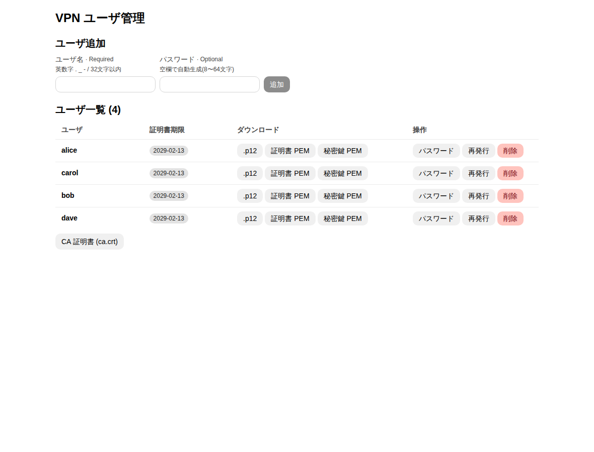
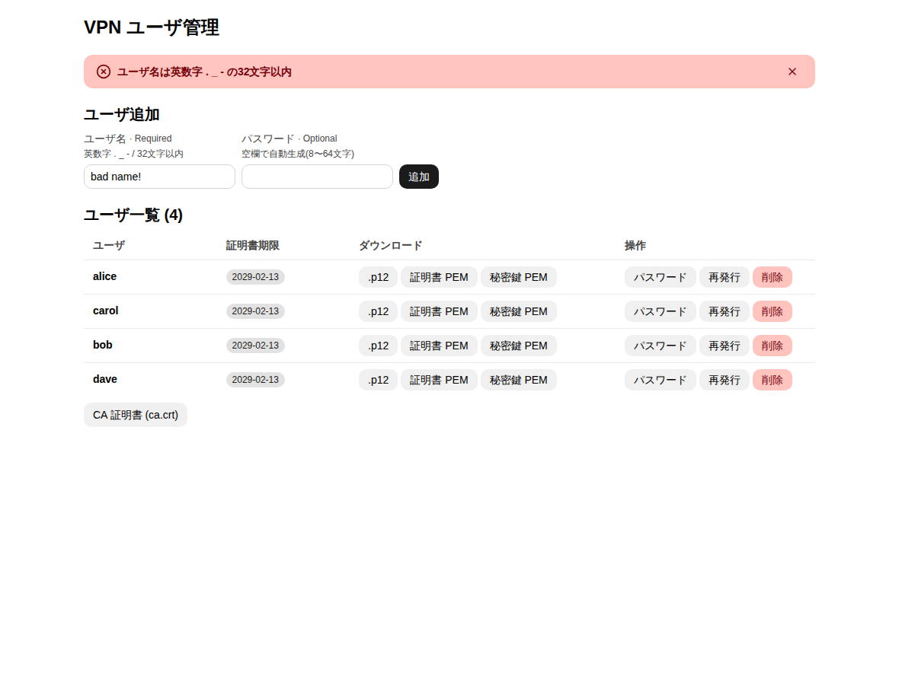
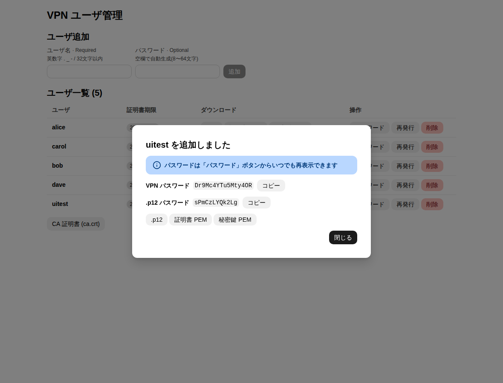
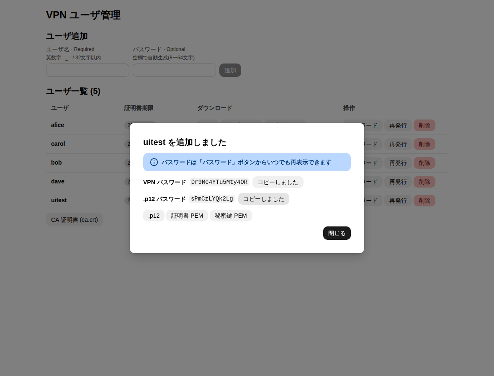
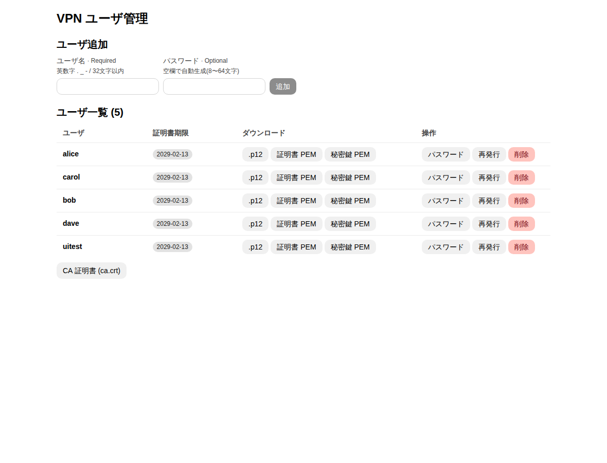
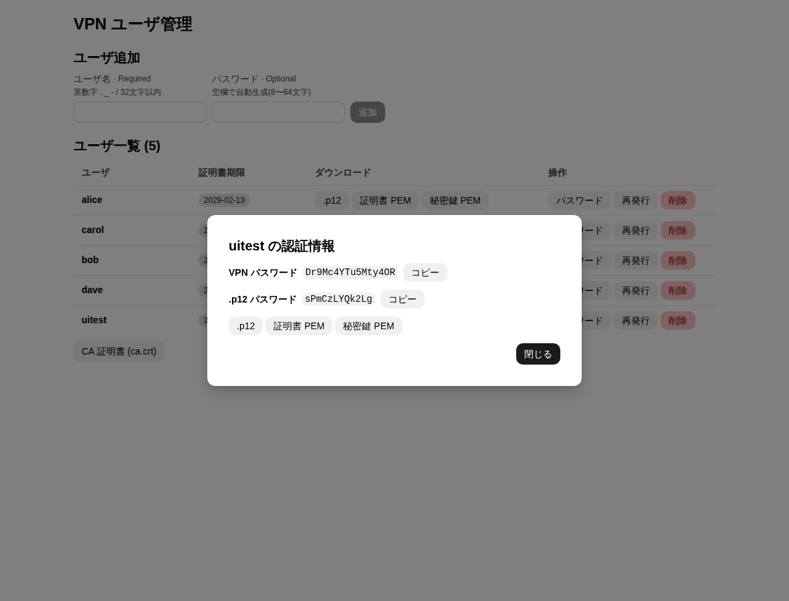
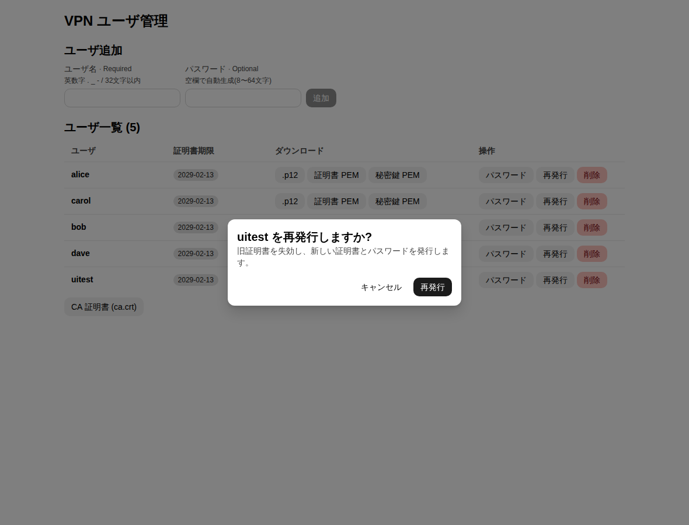
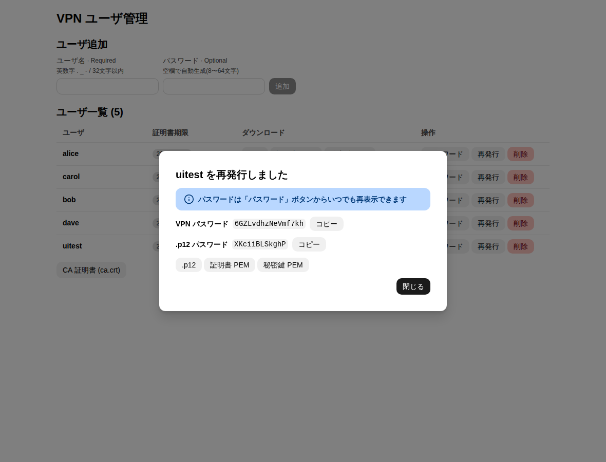
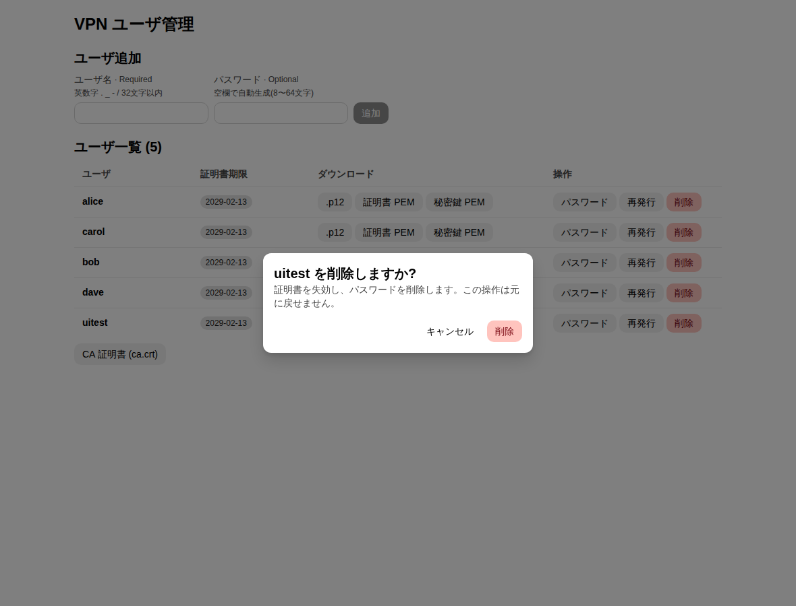
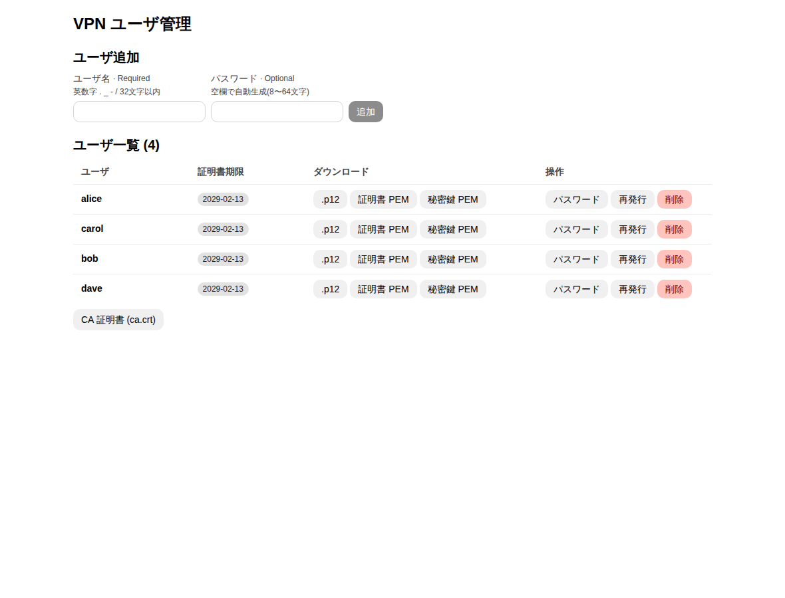

# テスト記録 (Astryx 管理画面 + strongSwan)

- 実施日: 2026-11-11
- 環境: Ubuntu 26.04 / Docker 29.1.3 / Compose 2.40.3 / strongSwan (Debian 13 パッケージ) / OpenSSL 3.5
- 管理画面: React 19.3.1 + **@astryxdesign/core 0.7.13** + @astryxdesign/theme-neutral 0.7.13 (Vite 8.3.8)
- ブラウザテスト: Playwright 1.56.0 (Chromium)
- 構成: `VPN_FQDN=vpn.example.com` / サーバ 192.168.90.10 / プール 192.168.90.128/25

## 結果サマリ

| 区分 | 項目数 | 結果 |
|---|---|---|
| 管理画面 UI (Playwright) | 20 | **全て PASS** |
| 管理API 認証/CSRF/入力検証 (curl) | 17 | **全て PASS** |
| ダウンロードファイルの検証 (openssl) | 5 | **全て OK** |
| VPN 接続 (UI で発行した資格情報) | 8 シナリオ | **期待どおり** |

最終実行: `tests/run-all.sh` → `rc=0`、PASS 37 件 / FAIL 0 件 (ログ: [docs/run-all.log](docs/run-all.log))。
証跡は [docs/evidence/](docs/evidence/) にあります。

> **開発中に実際の不具合を3件発見し修正しました** (後述「発見した不具合」)。いずれも修正後の最終実行で確認済みです。

## 再実行方法

```bash
docker compose up -d --build        # init-pki.sh 済み / .env 設定済みであること
./tests/run-all.sh                  # 全テスト。結果は docs/evidence/ に保存 (秘密鍵・p12は保存しない)
# 個別: tests/ui/run.sh A|B|C [user]   tests/api-security.sh   tests/e2e.sh <user...>
```

テストは `uitest` ユーザを作成・再発行・削除します (既存ユーザには触れません)。

---

## 1. 管理画面 UI (Astryx + Playwright)

実ブラウザ(Chromium)で `https://localhost:8443` を操作。テストコード: [tests/ui/ui-test.mjs](tests/ui/ui-test.mjs)

使用した Astryx コンポーネント: `Theme` / `Stack` / `Heading` / `Text` / `Button` / `TextInput` / `Table` / `Dialog` / `AlertDialog` / `Banner` / `Code` / `Badge`

### フェーズ A: 追加・コピー・ダウンロード

| # | 確認内容 | 結果 |
|---|---|---|
| A-1 | 既存ユーザの一覧表示 | PASS |
| A-2 | 不正なユーザ名 (`bad name!`) でエラーバナー表示 | PASS |
| A-3 | 追加後に VPN パスワード(16文字)/ .p12 パスワード(12文字)がダイアログ表示 | PASS |
| A-4 | **VPN パスワードのコピー**ボタン → クリップボードの内容が一致 | PASS |
| A-5 | **.p12 パスワードのコピー**ボタン → クリップボードの内容が一致 | PASS |
| A-6 | ダウンロード `.p12` (ファイル名 `uitest.p12`) | PASS |
| A-7 | ダウンロード 証明書PEM (`uitest.crt.pem`) | PASS |
| A-8 | ダウンロード 秘密鍵PEM (`uitest.key.pem`) | PASS |
| A-9 | PEM 証明書が `BEGIN CERTIFICATE` で始まる | PASS |
| A-10 | PEM 秘密鍵が `BEGIN PRIVATE KEY` で始まる | PASS |
| A-11 | p12 が DER 形式 (先頭 0x30) | PASS |
| A-12 | 一覧に新規ユーザが表示される | PASS |
| A-13 | 一覧行からの `.p12` ダウンロード | PASS |
| A-14 | `ca.crt` のダウンロード | PASS |
| A-15 | CA 証明書が `BEGIN CERTIFICATE` で始まる | PASS |
| A-16 | **パスワード再表示**: ダイアログを閉じた後、一覧の「パスワード」ボタンで VPN パスワードが追加時と一致 | PASS |
| A-17 | 再表示: .p12 パスワードが追加時と一致 | PASS |
| A-18 | 再表示: コピーボタンで取得した値が一致 | PASS |

### フェーズ B / C: 再発行・削除

| # | 確認内容 | 結果 |
|---|---|---|
| B-1 | 再発行の確認ダイアログ → 実行 → **パスワードが変わる** | PASS |
| C-1 | 削除の確認ダイアログ → 実行 → 一覧から消える | PASS |

### スクリーンショット

| 画面 | 画像 |
|---|---|
| 一覧 |  |
| 不正なユーザ名 |  |
| 追加完了 (パスワード表示) |  |
| コピー後 (「コピーしました」) |  |
| 追加後の一覧 |  |
| パスワード再表示 |  |
| 再発行の確認 |  |
| 再発行完了 |  |
| 削除の確認 |  |
| 削除後の一覧 |  |

※ スクリーンショットに写るパスワードはテスト用ユーザ `uitest` のもので、テスト終了時に失効・削除済みです。

---

## 2. ダウンロードファイルの検証 (openssl)

UI からダウンロードしたファイルを openssl で検証。証跡: [openssl-check.txt](docs/evidence/openssl-check.txt)

| 確認内容 | 結果 |
|---|---|
| ダウンロードした証明書が、ダウンロードした `ca.crt` で検証できる | OK |
| Subject=`CN=uitest, O=VPN`、EKU=`TLS Web Client Authentication`、期限 825日 | OK |
| 秘密鍵PEMと証明書の公開鍵が一致 | MATCH |
| p12 が正しいパスワードで開け、方式が 3DES/SHA1 (旧OS/古いクライアントとの互換用) | OK |
| p12 を誤パスワードで開くと `Mac verify error: invalid password?` | OK |

---

## 3. 管理API の認証・CSRF・入力検証 (curl)

テスト: [tests/api-security.sh](tests/api-security.sh) / 証跡: [api-security.txt](docs/evidence/api-security.txt)

| 確認内容 | 期待 | 結果 |
|---|---|---|
| 認証なし | 401 | PASS |
| 誤パスワード | 401 | PASS |
| 正しい認証で一覧取得 | 200 | PASS |
| CSRF: `X-Requested-With` 無しの POST | 403 | PASS |
| CSRF: 別オリジン(`Origin: https://evil.example`)からの POST | 403 | PASS |
| CSRF: ヘッダ無しの DELETE | 403 | PASS |
| 不正なユーザ名 (`a b;rm -rf`) | 400 | PASS |
| 短すぎるパスワード | 400 | PASS |
| パストラバーサル (`/dl/..%2f..%2fca%2fca.key`) | 404 | PASS |
| CA秘密鍵のダウンロード (`/dl/alice.cakey`) | 404 | PASS |
| 存在しないユーザのダウンロード | 404 | PASS |
| 認証情報API (`/api/users/<u>/credentials`): 認証なし | 401 | PASS |
| 同: 存在しないユーザ | 404 | PASS |
| 同: 不正なユーザ名 (`..%2fca`) | 404 | PASS |
| 同: 既存ユーザ | 200 | PASS |
| 旧版で発行したユーザ(alice): VPNパスワードは取得でき、.p12 パスワードは未保存 (`null`) | 一致 | PASS |
| `Content-Security-Policy: script-src 'self'` ヘッダ | あり | PASS |

---

## 4. VPN 接続テスト (UI で発行した資格情報)

別コンテナの swanctl クライアントから `192.168.90.10` へ接続 (証明書 + EAP-MSCHAPv2)。ログは `docs/evidence/vpn-login-*.log`。

| # | シナリオ | 期待 | 結果 | 証跡 |
|---|---|---|---|---|
| V-1 | UIで追加した直後のユーザ (正しい証明書+パスワード) | 接続成功 | **成功** (IKE_SA/CHILD_SA established、プールからIP払い出し) | [vpn-login-A.log](docs/evidence/vpn-login-A.log) |
| V-2 | 同 (正しい証明書 + 誤パスワード) | 拒否 | **拒否** (`EAP-MS-CHAPv2 ... ERROR_AUTHENTICATION_FAILURE`) | 同上 |
| V-3 | UIで再発行後の新しい証明書+新パスワード | 接続成功 | **成功** | [vpn-login-B.log](docs/evidence/vpn-login-B.log) |
| V-4 | 再発行後の証明書 + 誤パスワード | 拒否 | **拒否** | 同上 |
| V-5 | **再発行で失効した旧証明書** (パスワードは有効) | 拒否 | **拒否** (サーバログ `certificate was revoked on ...`) | [vpn-login-revoked-cert.log](docs/evidence/vpn-login-revoked-cert.log), [server-revocation.log](docs/evidence/server-revocation.log) |
| V-6 | UIで削除したユーザ (証明書+パスワード) | 拒否 | **拒否** | [vpn-login-deleted-user.log](docs/evidence/vpn-login-deleted-user.log) |
| V-7 | 削除後のサーバ状態: `listusers` から消える、`users.conf` に `eap-uitest` なし、接続定義 `rw` が残る | 一致 | **一致** | [server-after-delete.txt](docs/evidence/server-after-delete.txt) |
| V-8 | 既存ユーザ (alice/bob/carol/dave) は UI 操作の影響を受けない | 変化なし | 一覧に残存 (V-7) | 同上 |

---

## 5. 発見した不具合と修正

実際にテストして初めて分かった問題です。

### 不具合1: 管理画面からのユーザ追加で VPN サーバの設定が消える (重大)

- **症状**: UIでユーザ追加した直後、サーバログに `removed vici connection: rw` が出て、以後 `no IKE config found` で全員接続不可。
- **原因**: 管理画面コンテナの `swanctl --load-all` は自身の `/etc/swanctl`(空)を読み、「設定なし」としてサーバ側の設定を全てアンロードした。設定は `/app/swanctl` にマウントしていた。
- **修正**: `admin/Dockerfile` で `/etc/swanctl` → `/app/swanctl` のシンボリックリンクにした。
- **確認**: 管理画面コンテナからの `--load-all` で全ユーザの秘密と `rw` がロードされ、UI追加後も接続成功 (V-1)。

### 不具合2: 失効した証明書で接続できてしまう (重大)

- **症状**: 失効済み証明書でも接続成功。サーバログは `certificate status is not available`。
- **原因**: OpenSSL が出力する CRL に Authority Key Identifier (AKI) が無く、strongSwan が CRL と発行元 CA を結び付けられなかった (`swanctl --list-certs --type x509_crl` の `authKeyId` が空)。
- **修正**: `ca.cnf` に `crl_extensions=crl_ext` / `authorityKeyIdentifier=keyid:always` を追加 (`init-pki.sh` も同様)。
- **確認**: `authKeyId` が入り、失効済みは `certificate was revoked on ...` で拒否 (V-5)。
- **既存PKIの場合**: `ca.cnf` に上記を追記し、CRL を再生成して `swanctl --load-all`。

### 不具合3: 古い CRL がキャッシュされ、新しい失効が反映されない

- **症状**: 再発行で失効させた証明書で接続できる (CRL は更新済み)。
- **原因**: サーバ側に過去の CRL がキャッシュとして残り (同一発行元の CRL が2つ存在)、失効判定に古い方が使われた。
- **修正**: `scripts/common.sh` の `reload()` で `swanctl --flush-certs --type x509_crl` を実行してから `--load-all`。
- **確認**: 再発行・削除の直後に旧証明書が拒否される (V-5, V-6)。

### そのほか

- Astryx のテーマは `default` ではなく名前付きエクスポート (`import { neutralTheme } from '@astryxdesign/theme-neutral/built'`)。ビルドエラーで判明。
- Astryx の `Dialog` / `AlertDialog` は `role=dialog` ではなくネイティブの `<dialog>` 要素。テストでは `dialog[open]` で取得。
- `adduser.sh` の `reload` が、docker グループ外のユーザで失敗しても黙って成功扱いにしていた。失敗の表示と `sudo docker` へのフォールバックを追加。
- `.p12` は OpenSSL 3 の既定 (AES-256/PBKDF2) だと古い macOS/Windows/Android で開けないことがあるため、3DES/SHA1 (`-certpbe PBE-SHA1-3DES -keypbe PBE-SHA1-3DES -macalg sha1`) で書き出す。

---

## 6. 未実施・制約 (正直な記録)

- **実機クライアント**: Android strongSwan アプリ、Windows/macOS での .p12 の取り込みは未確認。接続テストは Linux の swanctl クライアント(同一Dockerネットワーク)のみ。
- **インターネット到達性**: VPN 接続後の実トラフィック (NAT 経由の外部通信) は未確認。
- **管理画面の外部遮断**: 8443 を許可IP以外から遮断する設定 (ufw + `DOCKER-USER`) は入れたが、許可外の回線からの接続拒否は未検証 (ホスト自身からの通信は `DOCKER-USER` を通らないため、この環境内では検証できない)。
- **再起動後の復旧**: ホスト再起動後の自動復旧は未確認。
- **失効ログの読み方**: `server-revocation.log` には、今回の証明書以外の失効エントリを含む行が複数出る。拒否の結果自体は V-5 のとおりだが、複数行が出る理由は未調査。
- **パスワードの保管**: VPN パスワードは EAP の仕様上 `users.conf` に平文、.p12 パスワードは `pki/clients/<user>/<user>.p12pass` に保存される (再表示のため)。旧版で発行したユーザの .p12 パスワードは保存されていないため、再発行するまで再表示できない。
- **CRL 期限**: 有効期間30日。操作が30日以上ない場合は手動更新が必要 (README 参照)。
- **負荷・同時操作**: 管理画面からの同時操作は排他ロックで直列化しているが、並行負荷のテストはしていない。Flask の開発サーバで動作している。
- **UI の自動テスト範囲**: モバイル幅・ダークモードは未検証 (`Theme mode` は system)。
